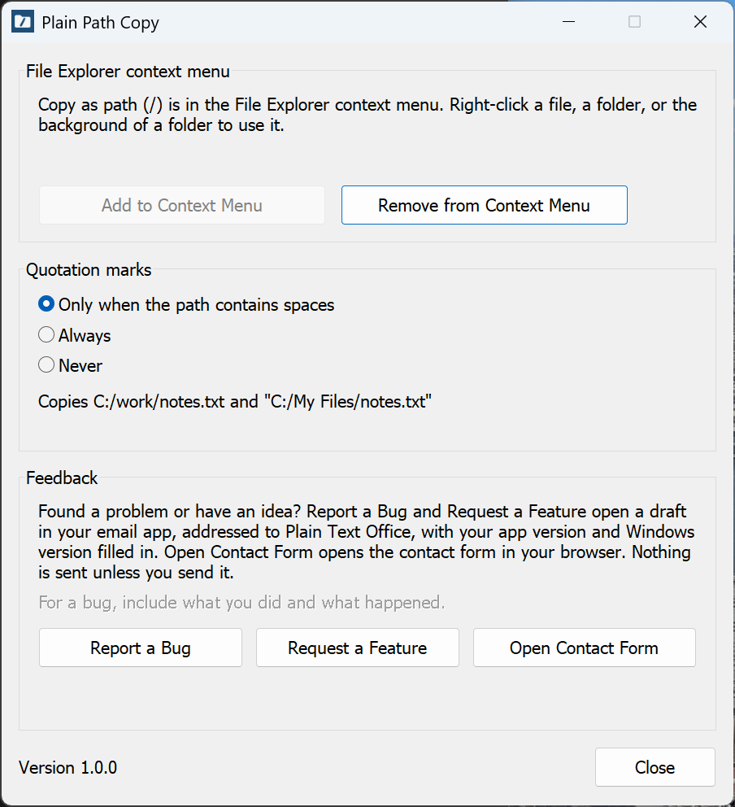

<!-- last_updated: 2026-11-25 -->
<!-- Authoring guidance: dev-docs/specs/README_SPEC.instructions.md -->
<!-- rumdl-disable MD033 MD041 -->

  

<h1 align="center">Plain Path Copy</h1>

  Adds Copy as path (/) to the Windows 11 File Explorer context menu, so you
  can copy file and folder paths with forward slashes.

  <a href="docs/USER_MANUAL.md">User manual</a>

<!-- rumdl-enable MD033 MD041 -->

---

## About

Windows' **Copy as path** copies `"H:\documents\work\notes.txt"`, but code,
shells, configuration files, and many tools want `H:/documents/work/notes.txt`.
Plain Path Copy adds a second command, **Copy as path (/)**, to the Windows 11
context menu itself, so you never need **Show more options**, and leaves
Windows' own command alone. It is a small, portable Windows app
for anyone who pastes paths into code or a terminal.

## Features

- Copies the paths of selected files and folders with forward slashes.
- Copies the open folder's path when you right-click the folder background.
- Copies several selected items at once, one path per line.
- Quotes paths only when they contain spaces, or always, or never.
- Turns network paths such as `\\server\share` into `//server/share`.
- Includes a feedback section for bug reports and feature requests.

## App Screenshot

<!-- rumdl-disable MD033 -->

  

<!-- rumdl-enable MD033 -->

## User Manual

See the [User Manual](docs/USER_MANUAL.md) for setup, usage, settings, and
troubleshooting.

## License

Plain Path Copy is licensed under the [MIT License](LICENSE).
Copyright © 2026 Plain Text Office LLC.
